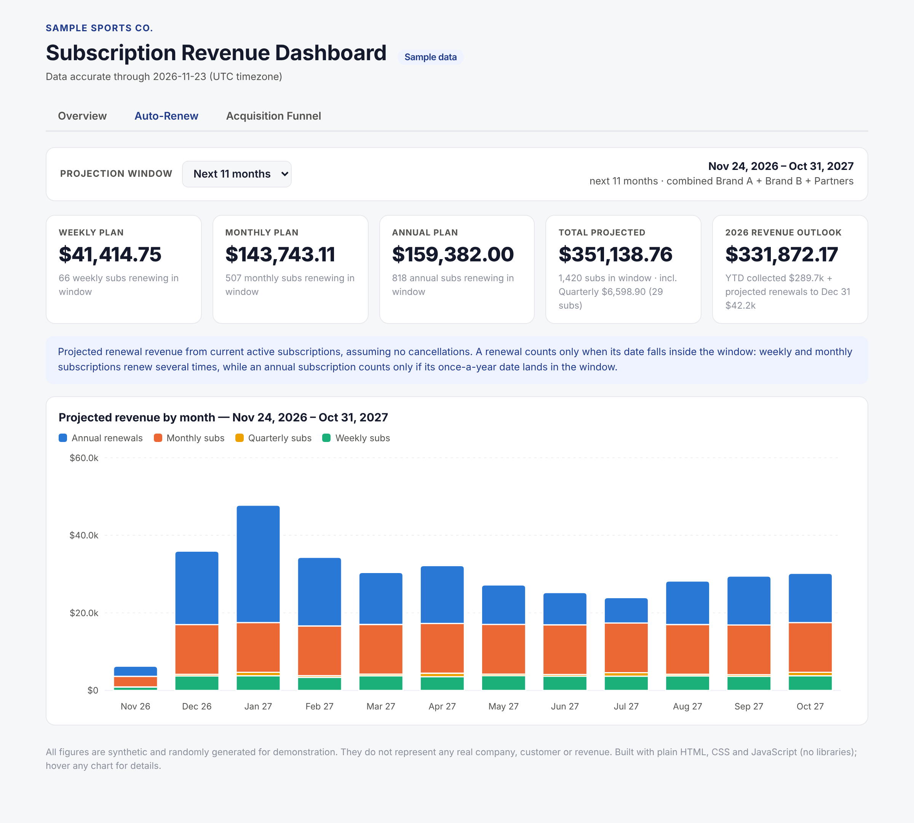
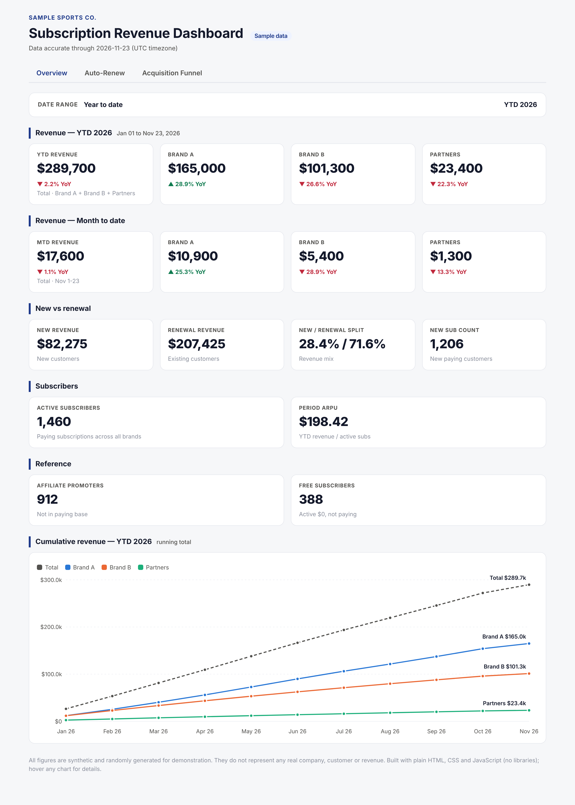
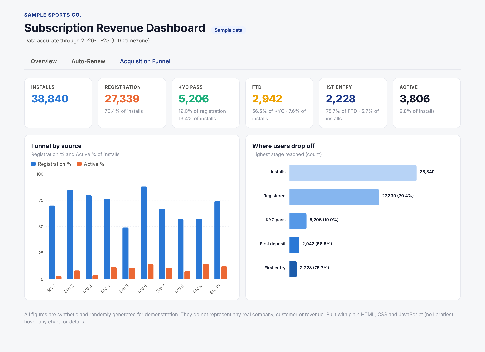

# Subscription Revenue Dashboard (sample data)

An interactive, single-page dashboard for subscription revenue, renewal projections and acquisition funnels, built with plain HTML, CSS, JavaScript and inline SVG (no chart libraries).

**[Open the live demo](https://sarahclarkbetsperts.github.io/subscription-revenue-dashboard/)**

> **All data is synthetic.** The numbers are randomly generated by `build.py` with a fixed seed. They do not represent any real company, customer or revenue.



| Overview | Acquisition funnel |
| --- | --- |
|  |  |

## What it shows

- **Overview:** YTD and month-to-date revenue by brand with year-over-year change, new vs renewal split, active subscribers and ARPU, and a cumulative revenue chart.
- **Auto-Renew:** projected renewal revenue by plan (weekly, monthly, quarterly, annual) over a selectable window. Projections are calculated in the browser from a table of 1,460 synthetic subscriptions. Weekly and monthly plans renew repeatedly; an annual plan counts only if its yearly date falls in the window; no cancellations are assumed.
- **Acquisition Funnel:** installs, registration, KYC pass, first deposit, first entry and active users, with a per-source comparison and a drop-off chart.

## Design choices

- Fixed colour per entity (for example annual plans are always blue), a colour-blind-safe palette, legends on multi-series charts, and light and dark mode.
- Hover tooltips on every chart, thin marks and a quiet grid so the data stays in focus.
- Each KPI is computed from the data, not typed in, so changing the data regenerates every number.

## Files

```
├── index.html               # the dashboard (data embedded, open directly in a browser)
├── template.html            # dashboard source without data
├── build.py                 # generates the synthetic data and builds index.html
├── data/sample_data.json    # the generated sample data
└── images/                  # screenshots used in this README
```

## Run or rebuild

Open `index.html` in any browser. To regenerate the data, run:

```
python build.py
```

Change the seed or the numbers at the top of `build.py` to produce a different dataset.

## Author

**Sapna Bhayal**, Solution Architect | Backend & Data
[LinkedIn](LINKEDIN-URL-HERE) · [GitHub profile](https://github.com/sarahclarkbetsperts)
